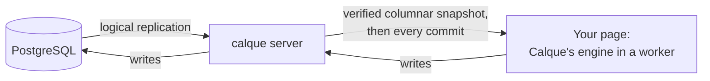

<p align="center">
  <picture>
    <source media="(prefers-color-scheme: dark)" srcset="docs/assets/calque-logo-animated-dark.svg">
    
  </picture>
</p>

<h1 align="center">Calque</h1>

<p align="center">
  <strong>Your PostgreSQL tables in the browser, complete and live.</strong>
</p>

Calque copies the tables you choose into the browser, whole or narrowed to one
tenant's rows, and keeps them in step with PostgreSQL. Filters, sorts, joins
and counts then run in the page, over every row, with no round trip to a
server.


<sub>Recorded over the benchmark's emulated 100 Mbit/s link, with readable
sample data. The times on screen are measured by the page during the
recording.</sub>

| 100,000 rows, in Chrome                  |       Time | Detail                                                    |
| ---------------------------------------- | ---------: | --------------------------------------------------------- |
| First visit, empty cache                 | **747 ms** | median; 618 ms of it is the 7.7 MB download at 100 Mbit/s |
| Coming back, from the browser's own copy | **172 ms** | median, nothing changed in between                        |
| PostgreSQL commit to the screen          |  **41 ms** | p95, while the database takes 11,000 row changes a second |
| Filter and sort every row                |  **35 ms** | p95                                                       |

Measured over an emulated 100 Mbit/s link with 30 ms of latency, every sample
checked row by row against PostgreSQL. The laptop was busy at the time, so the
numbers are directional. [How they were measured](docs/benchmark.md).

> [!WARNING]
> Calque is pre-alpha. APIs, protocol and storage formats change between
> releases, and there is no upgrade path yet: a new build asks you to clear
> the old state and prepare again.

## Why

You have probably built this before: an endpoint for the grid, another for
the counts, pagination, a cache in front of both, and a socket to tell the
page when it all went stale. Every new sort or filter is another request, and
the count can disagree with the rows next to it.

If the working set fits in the page, the page can simply hold it. Calque sends
all of it once, at a single PostgreSQL transaction, then streams every commit
that follows, from any backend, job or migration. Your queries run against
data that is complete and consistent, and you stop writing each sort twice.

The name is French for a tracing: a copy made by drawing over the original.

## Try it

You need Docker with Compose 2.17+, Node 22.23.4+, 24.22.1+ or 26.12.1+,
pnpm 11+ and Chrome. The demo pulls the server image, so you don't need Rust.

```sh
git clone https://github.com/calque-sh/calque && cd calque
pnpm install
pnpm demo
```

That starts a throwaway PostgreSQL 18, seeds it, and prints the URL of a live
dashboard (on macOS it opens it in Chrome). Run `pnpm demo:change` in another
terminal and watch the page follow the commit. `Ctrl-C` stops it, and
`docker compose down -v && rm -rf .calque-dev` starts over.

To point Calque at your own database and Vite app,
[Getting started](docs/getting-started.md) takes you from an existing
PostgreSQL 17 or 18 to a live page.

## The code

```ts
import { createSyncClient, eq } from "@calque/client";
import { schema } from "./calque.generated.js"; // typed from your tables

const client = createSyncClient({ endpoint, auth, grantVerificationKey, schema });

// Runs in the page, over every row.
const open = await client.db.tasks
  .query()
  .where(eq("done", false))
  .orderBy("id", "desc")
  .limit(100)
  .run();

// Stays live: the listener runs again whenever the rows change.
const tasks = client.db.tasks.query().orderBy("id").subscribe();
tasks.subscribe(() => render(tasks.getSnapshot()));

// Shows at once, confirmed when PostgreSQL sends the change back.
await client.db.tasks.update({ id: 1n }, { done: true });
```

React gets `useLiveQuery`, `useSuspenseLiveQuery` and `usePendingWrite` from
[`@calque/react`](client/packages/react/README.md). The
[client's README](client/packages/client/README.md) has the query rules and
every error a write can end with.

## What you get

- **All of it or none of it.** A collection is loaded completely or not at
  all, so a count never runs over half the rows. A browser without the memory
  for it gets `CAPACITY_EXCEEDED`, never a subset.
- **One moment in time.** Everything on the page comes from the same
  PostgreSQL transaction, and a commit that moves several queries updates
  them in the same frame.
- **Writes you can trust.** A write shows at once and stays pending until its
  change comes back from PostgreSQL. A retry never applies it twice.
- **Your backend decides who sees what.** It signs short-lived grants per
  user and tenant, and can revoke or narrow an open page's access.
- **Fast second visits.** The browser keeps an encrypted copy of the working
  set and catches up from it instead of downloading it again.
- **Types from your tables.** Rows, keys, queries and writes are typed, and
  queries are TypeScript, never SQL strings.
- **Tested against failure.** The suites kill the server outright, restart
  PostgreSQL, restore after the server's state and bucket are destroyed, and
  tamper with an artifact. Correctness, authorization and recovery hold
  through each.

## Where it fits

Calque fits apps where people work in one dataset all day: internal tools,
operations and support consoles, planning and reporting. Today it is built and
measured for:

- working sets of about 100,000 rows, with no claims beyond that yet;
- PostgreSQL 17 or 18 as the source;
- Chrome. The client's browser suites pass in Firefox too, and passed in
  WebKit on 2026-11-14, but only Chrome has been benchmarked.

Before you point it at your own schema:

- Every column a collection lists reaches the browser. Leave secrets, like a
  password hash, out of its `columns`.
- Visibility is per tenant, not per user. Finer rules need a projection table
  your application maintains.
- Writes are inserts, updates and deletes checked against the grant. No
  backend code runs on a write yet.
- Table names must be lowercase ASCII, and arrays, ranges, extension types
  and partitioned tables are refused.
  [What Calque needs from PostgreSQL](docs/postgresql.md) has the full list.

Calque is not offline-first, does not paginate or sync partial query results,
and has no SQL endpoint, by design: [`MANIFESTO.md`](MANIFESTO.md) explains
why.
[Not built in the pre-alpha](docs/design/architecture-guidelines.md#not-built-in-the-pre-alpha)
lists what is still missing.

## How it works



The `calque` server, one Rust binary, reads PostgreSQL's logical replication
into a durable log of its own and cuts each table into a compressed columnar
snapshot at an exact point in that log. A page downloads the snapshots its
grant allows, checks every chunk against its digest before any row shows,
and follows the log from there. Queries run in a worker, in 8 ms slices beside
the stream of live changes.
[The architecture guidelines](docs/design/architecture-guidelines.md) and
[`spec`](spec) have the details.

## Install

```sh
npm install @calque/client          # the browser client
npm install -D @calque/config       # the typed schema, as a Vite plugin or a CLI
docker pull ghcr.io/calque-sh/calque  # the server
```

React apps add `@calque/react`, and a Node backend signs grants with
`@calque/grant`. The Vite plugin needs Vite 8.1.4+, and `@calque/react` needs
React 19+. [Self-hosting](docs/self-host.md) runs the server behind HTTPS, and
[Building from source](docs/development.md#building-calque-from-source) covers
`cargo install`. This repository's `main` is the latest release; `dev` has
what has merged since.

## Documentation

- [Getting started](docs/getting-started.md): your database and Vite app to a
  live page.
- [`llms.txt`](llms.txt): the same, step by step, for a coding agent.
- [Self-hosting](docs/self-host.md): `calque serve` behind HTTPS with signed
  grants and S3-compatible storage.
- [Operations](docs/design/operations.md): settings, revocation, backups,
  tenants, capacity and limits.
- [The `calque` command](docs/cli.md) and
  [what it needs from PostgreSQL](docs/postgresql.md).
- [`@calque/client`](client/packages/client/README.md),
  [`@calque/react`](client/packages/react/README.md) and
  [`@calque/grant`](client/packages/grant/README.md).
- [The benchmark](docs/benchmark.md): the method, every threshold, and how to
  run it.
- [Developing Calque](docs/development.md): the build, the tests and CI.

## Contributing

Calque takes issues, not pull requests, while its internals still change
daily. [`CONTRIBUTING.md`](CONTRIBUTING.md) says what makes a report useful,
and [`SECURITY.md`](SECURITY.md) how to report a vulnerability privately.

## License

Calque is licensed under the Apache License 2.0 (`LICENSE`).
`vendor/pg-walstream` keeps its upstream BSD 3-Clause license,
`vendor/tokio-postgres` its MIT or Apache 2.0 license, and the Brotli decoder
compiled into the worker's `brotli-decoder.wasm` its MIT license; `NOTICE`
lists each.
